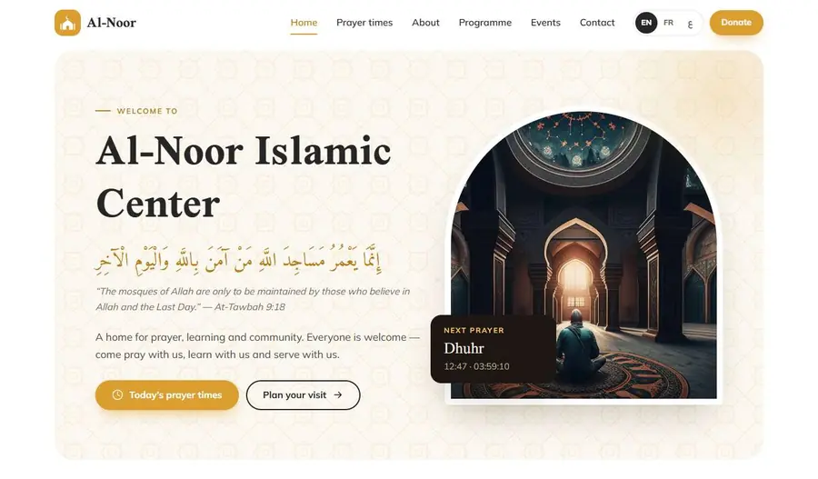
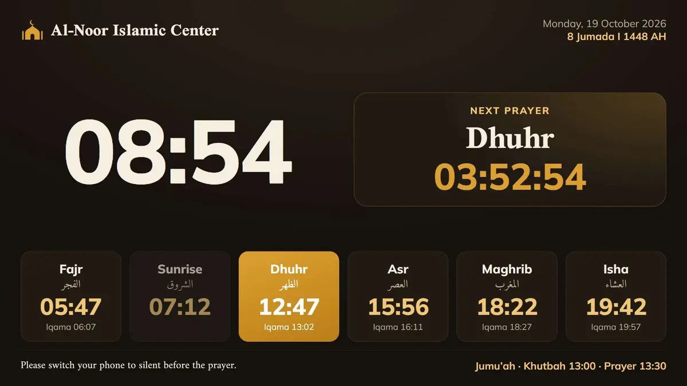

# Mosque template — Al-Noor

Free mosque website template: live prayer times for any city, Qibla, monthly timetable, prayer-hall TV screen. English, French, Arabic (RTL). No build step.

**Live demo:** https://abdelmoulabilel.github.io/mosque-website-template/

## Use it
- Click **Use this template** on GitHub (or download the ZIP), then open `index.html` — no install, no build.
- Publish for free: repo **Settings → Pages → Deploy from branch → main / root**.

## Customise
Edit **`js/config.js`**: name, contact, location (latitude, longitude, time zone), calculation method, iqama offsets, Jumu'ah, events, programme, donation link.
Edit **`js/i18n.js`** to change any sentence (English, French, Arabic).

Features
- Prayer times calculated in the browser (no API). Checked against Aladhan: same to the minute.
- Visitors can use their location or search any city (Open-Meteo geocoding). The method is picked by country.
- 24-hour prayer dial, next-prayer countdown, Hijri date, Qibla direction and phone compass.
- Printable monthly timetable. Optional reminder (sound + notification) while the tab is open.
- Languages: add `?lang=en`, `?lang=fr` or `?lang=ar` (right-to-left) to the URL.
- Past events hide themselves. "Add to calendar" downloads an .ics file.

## Prayer-hall screen
Open `display.html` full screen (F11) on the TV in the prayer hall: big clock, today's times, iqama countdown and rotating announcements, all from the same `js/config.js`.

## Credits
Code: MIT licence (see `LICENSE`). Photos come from earlier client projects or theme demos and are for demonstration only — replace them with your own images.
